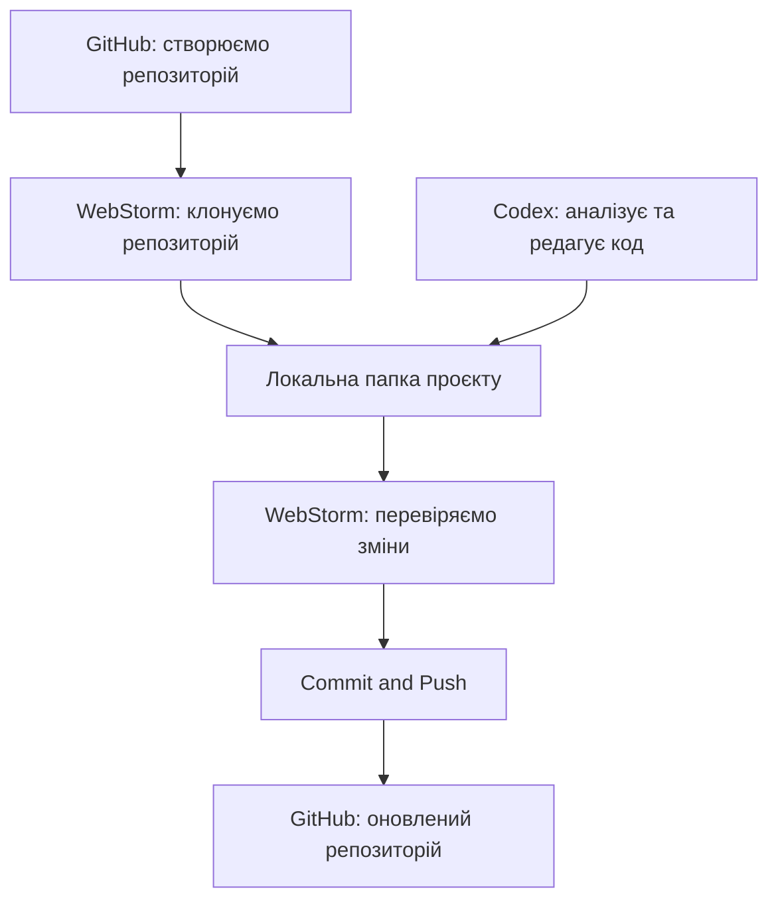

# Підключення ChatGPT до GitHub без використання Codex

Мета: підключити власний репозиторій GitHub до звичайного чату ChatGPT для роботи з навчальним проєктом.

Перед початком увійдіть у свої облікові записи [ChatGPT](https://chatgpt.com/) та [GitHub](https://github.com/).

## 10 посилань для підключення та перевірки

Переходьте за посиланнями по черзі, якщо попередній варіант не спрацював.

| № | Посилання | Призначення |
|---|---|---|
| 1 | [GitHub у ChatGPT](https://chatgpt.com/plugins/plugin_connector_1p_1a69035c238881919c4190932b2df699) | Сторінка плагіна GitHub. Основний варіант підключення. |
| 2 | [Каталог плагінів](https://chatgpt.com/plugins) | Знайдіть GitHub за назвою. |
| 3 | [Каталог застосунків](https://chatgpt.com/apps) | Альтернативний шлях до каталогу інтеграцій. |
| 4 | [Налаштування плагінів](https://chatgpt.com/#settings/Plugins) | Підключення та керування плагінами. |
| 5 | [Налаштування конекторів](https://chatgpt.com/#settings/Connectors) | Альтернативний шлях у налаштуваннях ChatGPT. |
| 6 | [Офіційна сторінка плагіна GitHub на сайті OpenAI](https://openai.com/business/plugins/github/) | Опис можливостей та перехід до встановлення. |
| 7 | [Безпосереднє встановлення конектора на GitHub](https://github.com/apps/chatgpt-codex-connector/installations/select_target) | Встановлення спільного конектора ChatGPT і Codex. |
| 8 | [Сторінка конектора на GitHub](https://github.com/apps/chatgpt-codex-connector) | Інформація про застосунок та можливість встановлення. |
| 9 | [Встановлені застосунки GitHub](https://github.com/settings/installations) | Перевірка встановлення конектора та доступу до репозиторіїв. |
| 10 | [Авторизовані застосунки GitHub](https://github.com/settings/applications) | Перевірка авторизації та наданих дозволів. |

Почніть із посилань **№ 1, 2 та 7**. Посилання № 3–5 залежать від версії інтерфейсу й можуть перенаправляти на іншу сторінку. Посилання № 9–10 призначені для перевірки, а не первинного встановлення.

## Як підключити репозиторій

1. Відкрийте плагін GitHub у ChatGPT та натисніть **Connect** або **Install**, якщо така кнопка доступна.
2. Авторизуйтеся на GitHub та підтвердьте необхідні дозволи.
3. Оберіть **Only select repositories** і надайте доступ лише до репозиторію свого навчального проєкту.
4. Поверніться до звичайного чату ChatGPT та виберіть GitHub через меню плагінів або `@GitHub`, якщо цей варіант доступний.
5. Перевірте підключення за допомогою запиту нижче.

## Перевірка підключення

Скопіюйте та надішліть у звичайному чаті ChatGPT:

> Покажи список моїх репозиторіїв GitHub через підключений конектор GitHub. Не використовуй вебпошук.

Якщо список отримано, спробуйте наступний запит:

> Прочитай файл README.md з мого репозиторію username/repository та поясни призначення проєкту. Використовуй підключений конектор GitHub, а не вебпошук.

Замініть `username/repository` на власну назву репозиторію.

## Важливо

- Назва **ChatGPT Codex Connector** не означає, що для встановлення обов’язково потрібно запускати Codex: це спільний конектор для ChatGPT і Codex.
- Старий [ChatGPT Connector](https://github.com/apps/chatgpt-connector) є приватним застосунком, тому не використовуйте його як основний спосіб встановлення.
- Доступність інтеграції у звичайному чаті залежить від тарифу, облікового запису та наданих дозволів. Робота на кожному безкоштовному акаунті не гарантована.
- Успішне читання репозиторію не гарантує можливості редагувати файли, створювати коміти чи виконувати push. Офіційна довідка описує стандартну інтеграцію GitHub як доступ для читання.
- Не надавайте доступ до всіх репозиторіїв, якщо для навчання достатньо одного.

Офіційна документація: [Connecting GitHub to ChatGPT](https://help.openai.com/en/articles/11145903-connecting-github-to-chatgpt).

---

## План Б: локальний Codex + WebStorm + GitHub

Якщо не вдалося підключити GitHub до звичайного чату ChatGPT або конектор дозволяє лише читати файли, скористайтеся локальним Codex. Цей спосіб не потребує підключення GitHub до ChatGPT.

### Локальний Codex тепер доступний безкоштовно!

**Станом на 27 листопада 2026 року Codex доступний навіть користувачам безкоштовного тарифу ChatGPT Free. Купувати ChatGPT Plus за $20 на місяць не потрібно.**

В [офіційній документації OpenAI: Using Codex with your ChatGPT plan](https://help.openai.com/en/articles/11369540-using-codex-with-your-chatgpt-plan) зазначено:

> Codex is included across ChatGPT plans, including Free and Go.

Тобто Codex включено до тарифів ChatGPT, зокрема Free та Go. Ліміти використання залежать від тарифу. Хмарний режим Codex Cloud не входить до Free та Go, але для нашого завдання він не потрібен: працюватимемо з файлами на власному комп’ютері.

### Крок 1. Встановіть та запустіть Codex

1. Перейдіть на [офіційну сторінку завантаження десктопного застосунку ChatGPT](https://chatgpt.com/download/).
2. Завантажте та встановіть застосунок для своєї операційної системи.
3. Запустіть застосунок та увійдіть у свій обліковий запис ChatGPT (Sign in with ChatGPT).
4. Відкрийте режим **Codex**. Якщо у вас уже встановлено окремий застосунок Codex, оновіть його за потреби.

Не потрібно купувати підписку Plus або створювати платний API-ключ. Інтернет потрібен, оскільки AI-модель працює на серверах OpenAI, хоча файли проєкту редагуються локально.

Докладніше: [офіційна документація десктопного застосунку](https://developers.openai.com/codex/app).

### Крок 2. Встановіть IDE та Git

Для вебпроєктів використаємо WebStorm від JetBrains. **WebStorm безкоштовний для некомерційного використання**, зокрема для навчальних некомерційних проєктів.

- [Завантажити WebStorm](https://www.jetbrains.com/webstorm/download/).
- [Завантажити Git](https://git-scm.com/downloads).
- [Умови безкоштовного використання WebStorm](https://www.jetbrains.com/help/webstorm/register.html).

Встановіть Git і WebStorm. Під час першого запуску WebStorm оберіть безкоштовну ліцензію для некомерційного використання (Free non-commercial use), якщо вона відповідає вашому проєкту, та увійдіть в обліковий запис JetBrains.

За необхідності перевірте, чи WebStorm знаходить Git: **Settings → Version Control → Git → Test**.

### Крок 3. Створіть репозиторій GitHub

1. Відкрийте [https://github.com/new](https://github.com/new).
2. Введіть назву репозиторію свого навчального проєкту.
3. Оберіть Public або Private відповідно до завдання.
4. Якщо створюєте новий порожній проєкт, додайте README.md, щоб репозиторій одразу мав початковий коміт.
5. Натисніть **Create repository**.

Якщо репозиторій проєкту вже існує, створювати новий не потрібно.

### Крок 4. Клонуйте репозиторій у WebStorm

1. Відкрийте репозиторій на GitHub, натисніть **Code → HTTPS** і скопіюйте URL.
2. У WebStorm на стартовому екрані натисніть **Clone Repository** або **Get from VCS** (назва залежить від версії IDE). Якщо інший проєкт уже відкрито, скористайтеся **File → New → Project from Version Control**.
3. Вставте скопійоване посилання, виберіть локальну папку та натисніть **Clone**.
4. За потреби авторизуйтеся в GitHub. Обліковий запис також можна додати через **Settings → Version Control → GitHub**.
5. Відкрийте клонований проєкт у WebStorm.

[Офіційна інструкція JetBrains з роботи з репозиторіями GitHub](https://www.jetbrains.com/help/webstorm/manage-projects-hosted-on-github.html).

### Крок 5. Доручіть Codex внести зміни до локального проєкту

1. Поверніться до десктопного застосунку в режимі Codex.
2. Додайте або відкрийте локальний проєкт, обравши **ту саму папку**, яку щойно клонували у WebStorm.
3. Якщо доступний вибір режиму роботи, оберіть **Local**, а не Cloud чи окремий Worktree, щоб зміни з’являлися безпосередньо у відкритому в IDE проєкті.
4. Опишіть завдання звичайною мовою. За необхідності підтвердьте доступ до папки та потрібні дії.

Приклад промпту:

> Проаналізуй файли мого навчального проєкту. Покращи дизайн головної сторінки, зроби її адаптивною для мобільних пристроїв і перевір працездатність. Внеси зміни безпосередньо до локальних файлів. Наприкінці коротко поясни, що саме було змінено. Не створюй коміти й не виконуй push: я зроблю це самостійно через WebStorm.

Якщо проєкт поки містить лише README.md, попросіть Codex створити початкову версію сайту відповідно до вашої ідеї.

Після виконання завдання поверніться до WebStorm. Зміни мають відобразитися в IDE, оскільки обидва застосунки працюють з однією локальною папкою. Перегляньте код і запустіть проєкт для перевірки.

### Крок 6. Відправте зміни на GitHub через WebStorm

1. Відкрийте вікно **Commit** у WebStorm (зазвичай `Ctrl + K` у Windows/Linux).
2. Перегляньте список змінених файлів та їхні відмінності (Diff).
3. Оберіть файли, які потрібно зберегти в репозиторії. Не додавайте `.env`, секретні ключі, паролі та службові файли, які мають бути в `.gitignore`.
4. Введіть повідомлення коміту, наприклад `Improve homepage design and mobile layout`.
5. Натисніть **Commit and Push** або спочатку **Commit**, а потім **Git → Push** (`Ctrl + Shift + K` у Windows/Linux).
6. Підтвердьте відправлення у потрібну гілку репозиторію.
7. Відкрийте репозиторій у браузері та переконайтеся, що новий коміт і змінені файли з’явилися на GitHub.

[Офіційна інструкція JetBrains: Commit and push changes](https://www.jetbrains.com/help/webstorm/commit-and-push-changes.html).

Якщо GitHub відхиляє push, перевірте авторизацію, право запису та правила захисту гілки. За потреби створіть окрему гілку й Pull Request.

### Як працює цей спосіб

### Скільки це коштує?

| Інструмент | Вартість для навчального некомерційного проєкту |
|---|---|
| ChatGPT Free | Безкоштовно |
| Локальний Codex | Безкоштовно в межах лімітів тарифу |
| WebStorm | Безкоштовно для некомерційного використання |
| Git | Безкоштовно |
| GitHub Free | Безкоштовно |
| ChatGPT Plus | Не потрібен |
| GitHub-конектор у ChatGPT | Не потрібен |
| Платний API-ключ OpenAI | Не потрібен |

**Результат:** Codex змінює код локально, ви перевіряєте результат у WebStorm, а IDE за допомогою Git відправляє зміни на GitHub. Таким чином, навіть без конектора у звичайному чаті можна продовжувати роботу над навчальним проєктом.

Доступність Codex Free підтверджено офіційною довідкою OpenAI станом на вказану дату. Ліміти можуть вичерпуватися, а інтерфейс та умови тарифів можуть змінюватися. Якщо Codex тимчасово недоступний, можна продовжити роботу у WebStorm, отримуючи код у звичайному ChatGPT і переносячи його у файли вручну.

